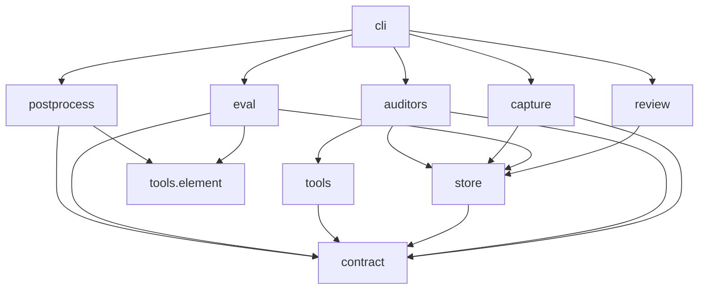
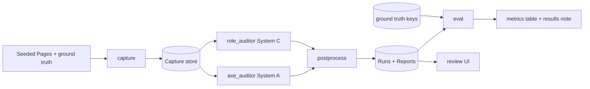
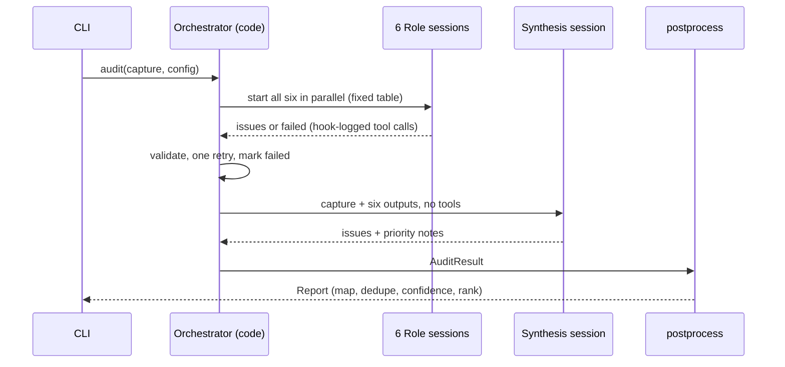

# Architecture Spine — SystemC_V1

## Design Paradigm

**Staged pipeline, systems as adapters.** Data flows through fixed stages; each stage reads files written by the previous one and writes its own. Systems under test (A, C, later B) are adapters behind one `Auditor` port that takes a loaded `Capture` and returns an `AuditResult` in the shared contract. Everything after the port (post-processing, scoring, review) is system-agnostic.

| Layer | Package | Role |
| --- | --- | --- |
| Contract | `contract/` | Pydantic models and closed enums: Issue, MergedIssue, GroundTruthItem, Run, Report, Role, Severity, ElementKey. No I/O. |
| Capture | `capture/` | Playwright; writes immutable Captures including every derived artifact. |
| Tools | `tools/` | Pure functions over a loaded Capture: contrast, readability, focus-trace reader, axe-result reader, `element.py` (element keys). |
| Auditors | `auditors/` | `axe_auditor` (A), `role_auditor` (C: orchestrator, role sessions, hooks). |
| Postprocess | `postprocess/` | Pure: map, dedupe, confidence, score, rank. |
| Eval | `eval/` | Matching rule, metrics, ablation. Pure over files. |
| Store | `store/` | Only module that touches `data/`, `results/`, `config/` files; also `store.config.load()` and the ledger. |
| Review | `review/` | FastAPI + Jinja screen. |
| Cli | `cli/` | One command per stage; batch runner. |

## Invariants & Rules



Dependencies point downward only. `eval`, `postprocess` and `review` never import `auditors`. `postprocess` and `eval` may import only `tools.element` from `tools`. `contract` imports nothing in the project. Nothing outside `store` opens project files.

### AD-1 — Auditor port is the only seam between systems and the harness

- **Binds:** FR-8, FR-37, FR-38, FR-19, later System B
- **Prevents:** Systems emitting different shapes; the harness special-casing a system.
- **Rule:** An auditor is `audit(capture, config) -> AuditResult` with `raw_issues`, `role_status` per role (incl. synthesis), `needs_review` (axe), `usage`, `seconds`, `tool_calls`. Post-processing, metrics and review accept only `AuditResult`/`Report`. Adding a system means one adapter; no harness change.

### AD-2 — One contract, defined once

- **Binds:** FR-3, FR-12, FR-13, FR-14, FR-16–FR-18, FR-21, FR-28
- **Prevents:** Schema drift between agents, post-processing, harness, ground truth and review.
- **Rule:** `contract/` defines all shared models; JSON Schema is exported from them, never hand-written. Contract changes bump `schema_version` and are additive.
  - `Issue` (agent- or adapter-set): `element` (selector string, may be absent), `criterion` (nullable), `rule_id` (nullable, axe native), `role`, `evidence`, `description`, `suggested_fix`, `derived_from[]` (synthesis only).
  - Code-set only: `element_key`, `roles`, `confidence`, `severity`, `rank`, `grounded`, issue `id` (hash of element_key + criterion + role).
  - `Role` is a closed enum: `screen_reader, keyboard, colour_visual, cognitive, plain_language, wcag_structure, inclusive_design, axe_core`.
  - `Severity` is a closed ordinal enum defined here; rank inputs (severity, confidence, issue_type) are defined here.
  - `GroundTruthItem`: `page_id`, `element_key`, `acceptable_criteria[]`, `affected_user_group`, `expected_roles[]`, `severity`, `issue_type` (R/J/M), `scope` (`element|page`), plus per-page `no_issue_criteria[]`.
  - `Report` embeds `run_id, system, phase, group_id, capture_hash, config_hash, postprocess_version, role_status, cannot_test_statement`, merged issues, and `priority_notes` (synthesis statements that are not Issues).

### AD-3 — Captures are immutable, complete, and pinned one per page

- **Binds:** FR-5, FR-6, FR-12, FR-37
- **Prevents:** Systems seeing different page state; hidden network calls; re-capture changing results; A and C disagreeing because they ran different captures.
- **Rule:** Capture writes `data/captures/{page_id}/{capture_hash}/` once. `capture.json` enumerates every artifact: HTML, computed styles, accessibility tree, screenshot, focus trace, axe results (full, incl. `needs_review`), contrast measurements, plus tool and focus-script versions. All derived artifacts are computed at capture time in the browser; `tools/` reads them and never launches a browser or re-runs axe. `capture_hash` covers a stated deterministic list (HTML, a11y tree, styles, axe results, focus trace; not screenshot bytes, not timestamps). The manifest pins one `capture_hash` per page; `eval` rejects Runs whose `capture_hash` differs from the pin or between systems. No code after Capture makes a network request to a page origin.

### AD-4 — Orchestrator is plain Python running isolated role sessions

- **Binds:** FR-8, FR-9, FR-12, FR-14, FR-15, FR-25
- **Prevents:** An LLM deciding which roles run; roles sharing context; one failure aborting the Run; ablation breaking the fixed table.
- **Rule:** `ROLES` is a fixed ordered table in code. The orchestrator starts exactly one independent Agent SDK session per role (`asyncio`, parallel), then one synthesis session after all six end or fail. Every session starts with `setting_sources=[]`, no `skills`, no `agents`, `cwd` = empty temp dir, and receives only its Role Spec inputs. Only synthesis sees other roles' output (all six). A role or synthesis error/timeout sets that `role_status=failed` and the Run continues. Ablation passes an `exclude` set to the same orchestrator; the Run records `variant`; a test fails if a non-ablation Run skips, adds or repeats a role.

### AD-5 — Tool allowlist is enforced by a fail-closed hook

- **Binds:** FR-11, FR-24, SM-5
- **Prevents:** A role calling an unassigned or built-in tool; the hook failing open; MCP tools ignoring `tools`.
- **Rule:** Role tools are in-process SDK MCP tools (`create_sdk_mcp_server`) over the loaded Capture, one server entry per role containing only that role's tools. Per session: `tools=[]` (the `tools` option does not restrict MCP tools), all built-ins in `disallowed_tools`, `mcp_servers` = that role's server only, `allowed_tools` = that role's `mcp__{server}__{tool}` names, and a `PreToolUse` `HookMatcher` with `on_failure="block"` that default-denies (`permissionDecision: "deny"`) any `tool_name` not on the allowlist (tool search is disabled, or `ToolSearch` is explicitly allowlisted) and logs every call (tool, args hash, role, time, allowed). Synthesis has no tools. Required tests: the hook fires for MCP tools; a raising hook blocks; an off-allowlist call is denied.

### AD-6 — Output gate: validate, one retry, then fail the role

- **Binds:** FR-13, FR-15, FR-24, SM-4
- **Prevents:** Malformed or evidence-free issues reaching post-processing; silent role loss.
- **Rule:** After a role ends, output is parsed against the contract and each Issue must have non-empty `evidence`. One retry with the validation error appended; a second failure sets `role_status=failed` and drops that role's issues. Retry and validity rates are recorded per role. Overall TP/FP/FN depend only on matching (AD-11); a failed role lowers recall through its missing issues and shows in role-scoped metrics.

### AD-7 — Config is one hashed unit; pins are what the SDK can enforce

- **Binds:** FR-10, FR-31, FR-33, FR-34, FR-35, SM-5
- **Prevents:** Unreproducible Runs; edits after freeze; claiming a temperature the SDK cannot set.
- **Rule:** `config/` holds model ID per phase, `effort` (set explicitly per model), `thinking` (adaptive only; Sonnet/Haiku 5.5 reject manual budgets), `max_turns`, `max_budget_usd`, Criteria Matrix, Role Specs, prompts, Guidance, Worked Examples, `provider_terms.md`. Temperature, `top_p` and `max_tokens` are not pinned (not exposed by the Agent SDK options per current docs); SDK sampling defaults are a stated limit and run-to-run agreement measures their effect. `task_budget` is advisory and may be ignored by the Claude Code runtime: do not rely on it unless a smoke test proves it changes behaviour. `config_hash` covers all of `config/`; every Run stores it plus SDK, CLI and tool versions. `freeze` writes a git tag and the hash; `eval` refuses to start if the hash differs, if `provider_terms.md` has no dated entry, or if any LLM system uses a different model ID. Prompt size in tokens and example counts are recorded per role in the Run.

### AD-8 — One cost ledger, reserve then settle

- **Binds:** FR-23, FR-32, SM-6
- **Prevents:** Concurrent sessions overspending; cost numbers that disagree with the cap; double counting.
- **Rule:** `store.ledger` is the only spend record: append-only JSONL with a file lock. Before a session starts it reserves its `max_budget_usd`; on end it settles with the last `ResultMessage` `total_cost_usd` and `model_usage` (cumulative in streaming mode: read the last value, never sum; `usage` alone omits subagents and compaction). Per-session `max_budget_usd` can overshoot, so the cap check keeps a margin of one session's budget. When remaining budget is insufficient to reserve, no new session starts, in-flight sessions finish, and the Run is `stopped_cost_cap`; a stopped run is resumed only by an explicit CLI flag, never silently. Costs are SDK estimates and are labelled so. Cap value is set from live pricing at build time.

### AD-9 — Files are the database; named, immutable or append-only

- **Binds:** FR-26, FR-27, FR-3, SM-2
- **Prevents:** Metrics that need the API; edited results; reviewer decisions leaking into scores.
- **Rule:** Layout is fixed (Structural Seed). `run.json` + `issues.jsonl` + `tool_calls.jsonl` are written once per Run and never rewritten. Reports are derived files `report.{postprocess_version}.json`, regenerable from a Run. Reviewer decisions are append-only `decisions.jsonl` beside the Report and are never read by `eval`. Repeated Runs share `group_id`; metrics aggregate by `(system, page_id, group_id)`. Ground truth and pages live in git under `data/`; `eval` verifies the ground-truth commit predates the first Run for that page. `eval` reads only files and makes zero API calls.

### AD-10 — Post-processing is pure and shared by every system

- **Binds:** FR-16, FR-17, FR-38, FR-22
- **Prevents:** A and C merged or ranked differently; confidence set by a model; two criterion mappings.
- **Rule:** `postprocess.run(audit_result, capture, matrix) -> Report` is pure. It is the only place a `criterion` is assigned: adapters emit native `rule_id` and optional `criterion`; postprocess expands rule_id through the Criteria Matrix deterministically (one rule may yield several criteria). Dedupe key is `(element_key, criterion)`. `roles` = sorted set of reporting roles excluding `inclusive_design` echoes (synthesis issues carry `derived_from[]` and never add a voter); `confidence = len(roles)`. `grounded` = element_key resolves to `node` in the Capture. Severity and rank follow one documented rule in `postprocess/rank.py` using the contract's inputs.

### AD-11 — Matching and metrics: one module, no knowledge of systems

- **Binds:** FR-4, FR-19–FR-25, SM-3
- **Prevents:** Different matching rules per system; double counting repeated problems.
- **Rule:** `eval/match.py`: a reported issue matches a ground-truth item when `element_key`s are equal and `criterion` is in `acceptable_criteria`; each item counts once; surplus matches are duplicates, not TP. Keys compare structurally (AD-15). Metrics consume `Report` + `GroundTruthItem` only. Breakdowns (role, type, page type, ranking, coverage, confidence, run-to-run agreement, synthesis-only issues) live in `eval/metrics/`.

### AD-12 — Dev/Test separation is checked by code

- **Binds:** FR-2, FR-10, FR-34, SM-C2
- **Prevents:** Prompts or examples built from Test pages; dev-model results in the final table.
- **Rule:** `data/pages/manifest.json` flags each page `dev` or `test`, records generator model, prompt file, review status, HTML hash and the pinned `capture_hash`. Worked Examples declare `source_page_id`; `freeze` fails if any source is a `test` or unreviewed page. Runs record `phase` (`dev`|`eval`) and model ID; `eval` scores only `phase=eval` Runs, on `test` pages, with the final model.

### AD-13 — Review screen is a read/write client of files only

- **Binds:** FR-28, FR-29, FR-30
- **Prevents:** UI coupling to agents; decisions mixed into Reports.
- **Rule:** `review/` (FastAPI + Jinja, server-rendered, semantic HTML) reads a Report through `store` and appends to `decisions.jsonl`. It never calls an auditor or LLM. Ungrounded issues need an override note to accept. Every screen shows the guidance-not-certification statement.

### AD-14 — Page generation is offline tooling outside the pipeline

- **Binds:** FR-1, FR-3
- **Prevents:** Generated pages or ground truth changing after review.
- **Rule:** `tools_dev/generate_page.py` writes a candidate page and draft ground truth. A page enters the manifest only after Fazeel marks it `reviewed`; its HTML hash is stored and a change resets review. Generator model ID is recorded.

### AD-15 — One element-key function, owned by `tools/element.py`

- **Binds:** FR-3, FR-4, FR-16, FR-19, FR-21
- **Prevents:** Postprocess and eval normalising selectors differently; ground truth that never matches any report.
- **Rule:** `element_key(capture_html, selector) -> ElementKey` is the only normaliser (parse HTML with one pinned parser; canonical path = tag + `nth-of-type` chain from root). `ElementKey` is a tagged union: `node(path)`, `nodes([path])` (axe multi-node), `page`, `unresolved(raw)`. It is code-set on Issue, MergedIssue and GroundTruthItem; ground truth selectors are resolved against the pinned Capture by a `bind-gt` step and stored as keys. `eval` compares keys only. Page-level and "absent element" problems use `page` scope; `unresolved` issues are never `grounded` and never match a `node` item.

### AD-16 — Failure, provider and operations envelope

- **Binds:** FR-15, FR-32, FR-35, FR-36
- **Prevents:** Undefined behaviour on API errors, synthesis failure, secrets leakage, lost results.
- **Rule:** Provider errors (timeout, 429, 5xx) get bounded retries with backoff inside a session budget, then become `role_status=failed` with `{stage, kind, message, retryable}`. A failed synthesis leaves the six role outputs reported and sets `synthesis=failed`. `ANTHROPIC_API_KEY` is read from the environment only, never logged or written to results; `.env`, `results/` and `data/captures/` are git-ignored and a pre-commit check blocks key-shaped strings. The batch runner skips Runs whose `run_id` exists; `results/` is backed up by a documented copy command before each Evaluation Run.

## Consistency Conventions

| Concern | Convention |
| --- | --- |
| Naming | Python `snake_case`; packages as in Design Paradigm; role ids from the `Role` enum only; system ids `axe`, `role_multi_agent` (later `single_agent`) |
| Ids | `page_id` = `type-nn` (e.g. `forms-02`); `run_id` = `system-UTCtimestamp-n`; `group_id` per repeated-run set; criteria as dotted strings (`"2.4.11"`) |
| Data & formats | JSON/JSONL UTF-8; timestamps ISO 8601 UTC; every file carries `schema_version` |
| Errors | Typed exceptions in `contract.errors`; stored failures `{stage, kind, message, retryable}`; no bare `except` |
| Logging | Structured JSONL next to each Run; no `print` in library code |
| State | Pure functions in `tools`, `postprocess`, `eval`; side effects only in `store`, `capture`, `auditors`, `review`, `cli` |
| Config | Read only through `store.config.load()`; only `auditors` reads `ANTHROPIC_API_KEY` |
| Tests | `pytest`; matching, element_key, postprocess, allowlist hook (fail-closed), ledger, role-table and the T1-T9 fixture have unit tests |

## Stack

| Name | Version |
| --- | --- |
| Python | 3.12 (FastAPI 0.165 needs 3.11+) |
| uv | latest (project and lock manager) |
| claude-agent-sdk | 0.2.187 (require >=0.2.177 for hook `on_failure`) |
| Claude models | `claude-sonnet-5-5` (eval), `claude-haiku-5-5` (dev) |
| Playwright (Python) | 1.65.2 |
| axe-core | 4.14.1 (MPL-2.0), vendored `axe.min.js` |
| pydantic | 2.14.4 |
| FastAPI + Jinja2 | FastAPI 0.165.0 |
| pytest, ruff | latest at pin time |

Versions verified against PyPI/npm by a reviewer on 2026-11-21; re-run `pip index versions` / `npm view` at pin time.

## Structural Seed





**Deployment and environments.** Local laptop only. Phases: `dev` (Haiku, Dev pages) and `eval` (Sonnet, frozen config, Test pages). Secret via environment only (AD-16). No CI, hosting or database. Only Seeded Page content and prompts go to the Anthropic API; provider terms are read and dated in `config/provider_terms.md` before the first LLM Run (AD-7). Remote capture and robots.txt handling (FR-7) arrive with real pages; Seeded Pages are local files.

```text
SystemC_V1/
  config/            models, effort, limits, matrix, role specs, prompts, examples, provider_terms.md
  contract/          pydantic models, enums, exported JSON Schema
  capture/           playwright capture, focus-trace script, axe + contrast at capture time
  tools/             contrast, readability, focus_trace, axe_reader, element.py (pure)
  auditors/          axe_auditor.py, role_auditor/ (orchestrator, sessions, hooks, sdk_tools)
  postprocess/       map, dedupe, confidence, score, rank
  eval/              match.py, metrics/, ablation.py, bind_gt.py
  store/             paths, readers, writers, config loader, ledger
  review/            fastapi app, templates
  cli/               one command per stage, batch runner
  tools_dev/         page generator (outside pipeline)
  data/pages/        seeded pages + manifest.json              (git)
  data/ground_truth/ one file per page                         (git)
  data/captures/     {page_id}/{capture_hash}/                 (ignored)
  results/           {system}/{page_id}/{run_id}/ run.json issues.jsonl tool_calls.jsonl report.*.json decisions.jsonl (ignored)
  tests/
```

## Capability → Architecture Map

| Capability / Area | Lives in | Governed by |
| --- | --- | --- |
| Seeded pages, manifest, ground truth (FR-1–3) | `tools_dev/`, `data/`, `eval/bind_gt.py` | AD-12, AD-14, AD-15, AD-9 |
| Capture and cache (FR-5–6) | `capture/`, `store/` | AD-3 |
| System C (FR-8–15) | `auditors/role_auditor/`, `tools/` | AD-4, AD-5, AD-6, AD-7, AD-16 |
| System A (FR-37–38) | `auditors/axe_auditor.py` | AD-1, AD-3, AD-10 |
| Post-processing and Report (FR-16–18) | `postprocess/` | AD-10, AD-2, AD-15 |
| Evaluation (FR-19–27) | `eval/` | AD-11, AD-9, AD-15 |
| Review Screen (FR-28–30) | `review/` | AD-13 |
| Config, cost, freeze, terms (FR-31–36) | `config/`, `store/`, `cli/` | AD-7, AD-8, AD-12, AD-16 |

## Deferred

- **System B (single agent) adapter and B0:** plugs in behind AD-1; runtime (SDK single session vs raw API) decided when B is built. Raw API would restore temperature control.
- **Real and W3C pages, human labelling, FR-7 robots.txt, redaction:** same `data/` layout, new manifest entries and a remote-capture module; added then.
- **Cost Cap value:** from live pricing at build time (AD-8).
- **Severity scale values and rank formula:** the enum and rank inputs are fixed in `contract/` (AD-2); the numeric rule is written in `postprocess/rank.py` during build.
- **Statistics (Wilcoxon, bootstrap), expert kappa:** dissertation phase.
- **Sampling control:** revisit if run-to-run variance is too high for the 3-run design.
